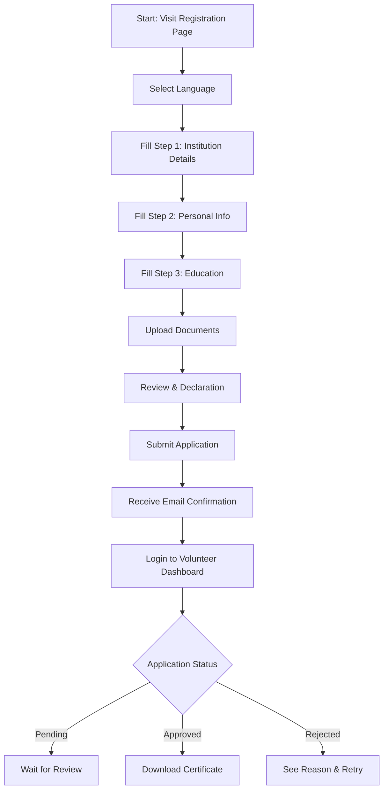
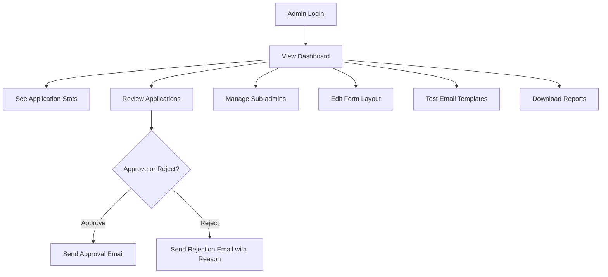

# 🌟 NSS Registration System

A comprehensive **National Service Scheme (NSS)** volunteer registration and management system built with **Next.js 15**, **MongoDB**, and modern web technologies.

---

## 📚 Table of Contents

- [Features](#-features)
- [Technology Stack](#-technology-stack)
- [Getting Started](#-getting-started)
- [App Usage Guide](#-app-usage-guide)
  - [Volunteer Flow](#volunteer-flow)
  - [Admin Flow](#admin-flow)
- [Flow Diagrams](#-flow-diagrams)
  - [Volunteer Dashboard Flow](#volunteer-dashboard-flow)
  - [Admin Dashboard Flow](#admin-dashboard-flow)
- [Permission System](#-permission-system)
- [Deployment](#️-deployment)
- [Contributing](#-contributing)
- [License](#-license)
- [Support](#-support)

---

## ✨ Features

### 👤 For Applicants (Volunteers)
- Multi-step Registration Form (4 steps, real-time validation)
- Bilingual Support (English & Hindi)
- Form Preview before submission
- Email Notifications for every status update
- Secure Document Upload

### 🛠️ For Administrators
- Admin Dashboard with analytics
- Application Review (approve/reject with reason)
- User Management (Admins/Sub-admins)
- Automated Email System
- Reports & Real-time Analytics
- Role-based Access Control

---

## 🧱 Technology Stack

| Layer         | Tech Used                            |
|--------------|----------------------------------------|
| **Frontend**  | Next.js 15, React 19, TypeScript       |
| **Styling**   | Tailwind CSS v4, Custom Design System  |
| **Backend**   | Next.js API Routes, MongoDB, Mongoose  |
| **Auth**      | NextAuth.js with JWT, RBAC             |
| **Forms**     | React Hook Form + Zod Validation       |
| **Email**     | Nodemailer with HTML Templates         |
| **UI**        | Radix UI Primitives                    |

---

## 🚀 Getting Started

### ✅ Prerequisites

- **Node.js** v18 or later
- **MongoDB** (Atlas or local)
- **SMTP** Email service (e.g. Gmail, SendGrid)

### 🔧 Installation

1. **Clone the repository**
    ```bash
    git clone https://github.com/your-username/nss-registration-system.git
    cd nss-registration-system
    ```

2. **Install dependencies**
    ```bash
    npm install
    ```

3. **Configure Environment Variables**

    Create a `.env.local` file in the root directory and add:
    ```
    MONGODB_URI=your_mongodb_connection_string
    NEXTAUTH_SECRET=your_nextauth_secret
    EMAIL_SERVER_USER=your_email@example.com
    EMAIL_SERVER_PASSWORD=your_email_password
    EMAIL_SERVER_HOST=smtp.example.com
    EMAIL_SERVER_PORT=587
    ```

4. **Run the development server**
    ```bash
    npm run dev
    ```

5. **Open the app**
    - Visit [http://localhost:3000](http://localhost:3000) in your browser.

---

## 🧑‍💻 App Usage Guide

### Volunteer Flow

1. **Go to Registration Page**
2. **Select Language** (English/Hindi)
3. **Fill Multi-step Form**
    - Step 1: Institution Details
    - Step 2: Personal Information
    - Step 3: Educational Background
    - Step 4: Review & Declaration
4. **Upload Required Documents**
5. **Preview All Details**
6. **Submit Application**
7. **Check Email for Confirmation**
8. **Login to Dashboard to Track Status**
    - See: Pending, Approved, or Rejected
    - Download certificate if approved

### Admin Flow

1. **Login as Admin**
2. **Access Admin Dashboard**
3. **View Application Stats**
4. **Review Applications**
    - Approve or Reject (with reason)
    - Send status emails automatically
5. **Manage Sub-admins**
    - Add, edit, or remove sub-admins
    - Assign permissions
6. **Edit Form Layout (if needed)**
7. **Test Email Templates**
8. **Download Reports**

---

## 🗂️ Flow Diagrams

### Volunteer Dashboard Flow



---

### Admin Dashboard Flow



---

## 🔐 Permission System

| Role       | Access Level                      |
|------------|----------------------------------|
| Admin      | Full access to all features       |
| Sub-admin  | Limited access (assignable)       |
| User       | Form submission & tracking only   |

- Permissions enforced in UI and backend.
- Sub-admins can be created/managed by Admins.

---

## ⚙️ Deployment

To build for production:

```bash
npm run build
npm start
```

You can deploy on **Vercel**, **Render**, or **DigitalOcean App Platform**.

---

## 🤝 Contributing

1. Fork this repository
2. Create a new feature branch
3. Commit your changes
4. Submit a Pull Request

All contributions are welcome!

---

## 📄 License

MIT License

---

## 📞 Support

- Open an issue on GitHub
- Email the dev team
- See the `/docs` folder for more help

Developed for the National Service Scheme (NSS), Uttar Pradesh 🇮🇳

---
